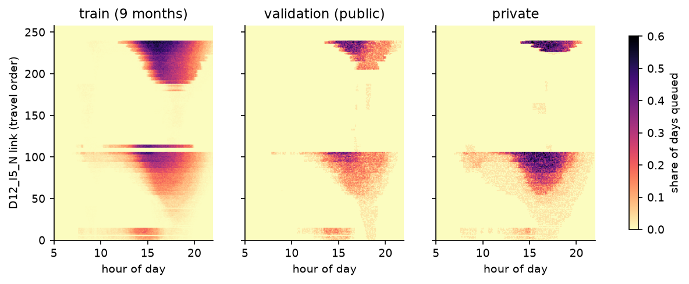
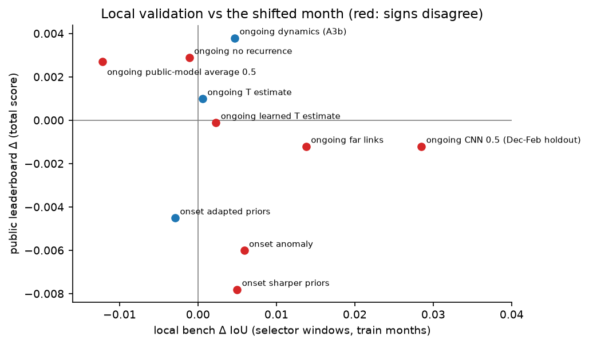
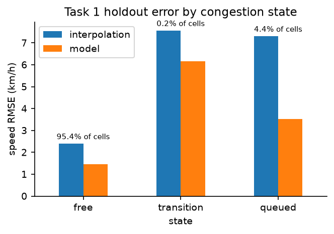
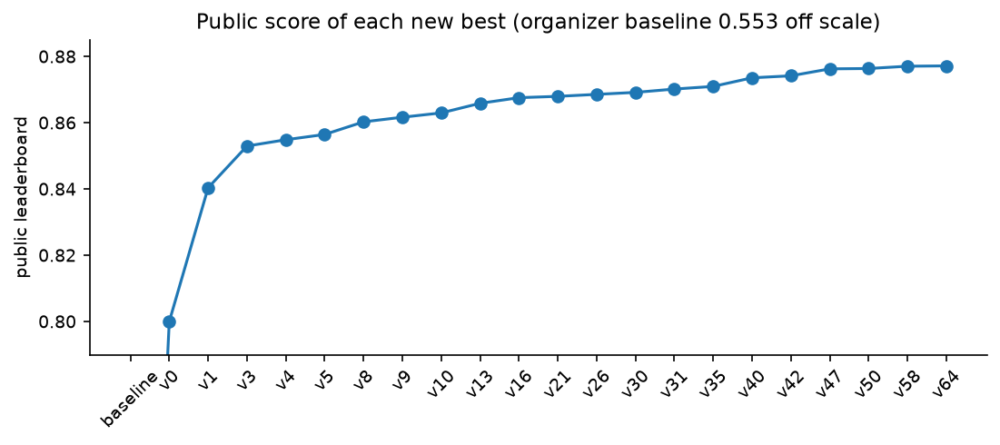
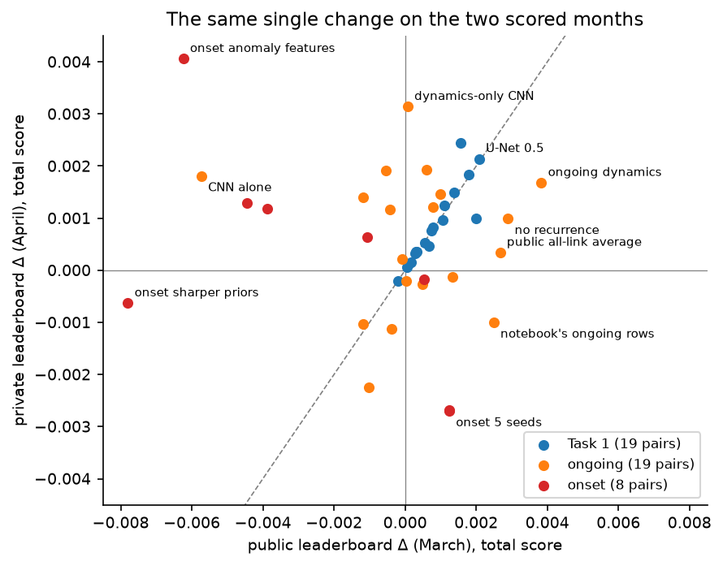

# TrafficFlowBench 2026: robust reconstruction and forecasting under a month shift

**Team:** jarski, a one-person team (Jarno Rantala) · **Competition:** 2026 IEEE Big Data Cup – TrafficFlowBench · **Report of 2026-11-09, revised 2026-11-18** (Section 7.1, comparison with other teams) **and 2026-11-23** (corrections after the final ranking and five late submissions: Sections 2.2, 3.2, 4, 5.1, 5.6, 7, 7.1 and 9, and the new Section 7.2)

**Selected final submission:** v64, public leaderboard 0.87721, produced by `python -m tfb.pipeline_final --out final --fresh` at git commit `e89d9c4`. **Private leaderboard: 0.86769.** The second selected submission, v52 (public 0.87643, private 0.86647), is the same configuration with the one leaderboard-tuned setting of Task 2 left at its untuned value (Section 5.3).

## Summary

I address all four TrafficFlowBench tasks with one deterministic pipeline that rebuilds the submission from the released data in about two hours. Every component sits on a physically motivated baseline, and every design choice is backed by a train-split experiment, a paired leaderboard test, or both; where only the leaderboard supports a choice, this report says so.

- **Task 1, state reconstruction.** Linear time interpolation corrected by an average of three model families: a LightGBM residual model whose key features are the neighbours' departures from their own interpolation (a passing congestion wave shows there first), a second LightGBM on a public 94-feature set, and a 2-D U-Net over each day's time × link grid that learns to complete the masked map. Held-out S_state rose from 0.909 (interpolation) to 0.948, close to the measurement-noise ceiling.
- **Task 3, physics.** I show that the conservation score can be computed locally, because the hidden boundary flux equals the observed change in accumulation, and that measurement noise caps it well below 1. Density-targeted flow adjustment and the U-Net recover part of the remaining gap.
- **Task 2, queue forecasting.** *Onset:* the selector guarantees that an onset queue first appears exactly at T+30, so the question is which links break first; a LightGBM over (event, link) with time-of-day priors and an expected-IoU set rule. *Ongoing:* a (link, step) LightGBM on queue geometry and current dynamics (gap-bridged segments, recovery, arriving demand, tail motion), a causal estimate of links masked at the origin, and an average with a simpler all-link model from a public notebook, whose two blending weights are set separately on and off the cells my own model scores.
- **Task 4, OD estimation.** A non-negative ridge projection of each month's own prior. Paired leaderboard probes show the hidden reference behaves like this projection (S_ODME ≈ 0.993).

**Central finding.** The two scored months were generated independently of the nine training months, and the training months are near copies of each other. Validation and private both activate a different subset of the same bottlenecks. Month-held-out validation cannot see this shift: five changes that won on local validation lost or did nothing on the leaderboard, including a convolutional model that beat everything on the training split, while the one ongoing model that lost on the training split gained the most on the leaderboard. I therefore used paired single-change submissions as the measuring instrument for shift-sensitive decisions, kept the local bench for shift-free mechanics, and preferred current-dynamics features and adaptation to the scored month over anything that memorizes the training scenario. The public score rose from the organizer baseline's 0.553 to 0.877; the final private score is 0.868.

**What the second scored month showed.** After the private leaderboard was published, every paired test could be re-read on April (Section 7.1). All 22 Task 1 and Task 4 changes transferred with the same sign and nearly the same size, so the Task 1 pipeline is well validated. For Task 2 the public month was a much weaker judge: 9 of 15 clear ongoing verdicts and 1 of 7 onset verdicts kept their sign. Large mechanistic changes held; model-family and onset choices did not. Of the +0.013 that Task 2 tuning gained on March, +0.003 survived on April, while Task 1's +0.024 survived in full. The one shifted month with 40 windows per family that this report used as its instrument for Task 2 was not enough to rank small Task 2 changes, and the report says where that led it astray.

**What five late submissions showed (2026-11-23, Section 7.2).** In the final ranking this submission is 33rd of the 69 teams with a final package (gold 0.928, bronze 0.902). Afterwards I tested four open questions with late submissions. Two results correct this report. First, both scored months contain 90-minute spans that are blank on every link, and the training months do not. My holdout did not contain them, so it overstated S_state (0.948, against 0.937 on the leaderboard). The spans cost 0.0057 of total score, and a span-aware U-Net recovers +0.0022 on both months. Second, the hypothesis that Section 5.6 rejected was right, and my test of it was wrong: the window selector leaves a regularity in ongoing windows, and training on windows chosen as the selector chooses them gains +0.0011 on the public month and +0.0036 on the private month.

## 1. Problem and scoring

S_total = 0.35·S_state + 0.30·S_queue + 0.15·S_physics + 0.20·S_ODME. Each component is averaged over directional panels, then over corridor families.

- **Task 1:** 20, 30 or 50% of cells are hidden per day (regimes R1, R2, R3). Speed and per-lane flow are scored by RMSE against the noisy observation, with scales of 25 km/h and 600 veh/h/lane.
- **Task 2:** 5 onset and 5 ongoing windows per panel and month. Space-time IoU against noise-free queue labels (speed ≤ 0.6 free speed) for T+5..T+30, from a 60-minute history before the origin T.
- **Task 3:** scored on the Task 1 values: one third fundamental-diagram consistency, two thirds vehicle conservation.
- **Task 4:** path flows scored against a hidden reference: OD, link fit, deviation from the prior, attraction.

## 2. Data and evaluation methodology

### 2.1 Representation and measurement noise

- **Dense arrays.** Each panel and split becomes `[day, 288, link]` arrays (built in 30 s). There is one detector station per link. Links are kept in travel order: south- and westbound panels are stored reversed in the release, verified from the released topology, so that index + 1 is always downstream. The loader accepts releases with rows, days or files absent, which the award check requires.
- **Noise from physics.** Adjacent ramp-free links carry the same 5-minute flow, so their difference isolates measurement noise: about 2.7% of flow (100–170 veh/h) and 1.3–2.8 km/h of speed, nearly independent in time (lag-1 autocorrelation mostly below 0.15). Readings with low `pct_observed` are not noisier: the second-difference RMS is flat across quality buckets. The noise sets hard ceilings for Tasks 1 and 3 (Sections 3 and 4).

### 2.2 Local scoring I can trust

- **Task 1 and Task 3** scorers were re-implemented on dense arrays and checked to 6 decimals against the official scorers (0.2 s per panel). The Task 1 holdout protocol throughout is: train on June–November, score December–February with the real released masks.
- **Task 3 on train.** The documentation says Task 3 cannot be scored locally, but the organizer boundary flux is "projected onto the released observations". It therefore equals the observed change in accumulation, which makes the conservation residual Σ|ΔN_sub − ΔN_obs| / Σ|ΔN_obs|. Rebuilding the flux this way gives S_LWR = 1 for the truth, and the organizer's historical-mean baseline scores exactly as on the leaderboard.
- **Task 2 test bench.** Leave-one-month-out evaluation on three window sets: the 80 official training windows; my replica of the organizer's window selector run on every training month (a forward scan with 6-hour spacing, persistence IoU ≤ 0.9 and history coverage ≥ 0.7; it reproduces 39/40 official onset windows and 14/40 ongoing ones; with the persistence cap tested on a time-filled queue state it reproduces 37/40, which I found only after the deadline, Sections 5.6 and 7.2); and every replicated window (2,327 onsets, 11,321 ongoing). It also reports the model's self-assessed IoU, so calibration is visible.

### 2.3 Causality of Task 2 inputs
Task 2 may use only data timestamped at or before T, including the observation at T itself (organizer ruling of 2026-10-15). Two automated tests enforce this:

- a feature-level test rebuilds the features of all 160 scored windows with every value after T blanked (the rest of the day, later days, ramps) and requires identical features; planted leaks (mainline data after the buffer, ramps inside the horizon, the next day) are caught;
- a file-level test performs the organizers' award check: for each scored window it writes a copy of the release with every row stamped after the origin removed from every file, rebuilds the arrays, predicts, and requires the prediction to equal the submitted rows. All 160 windows pass for the final submission.

### 2.4 The scored months are shifted
I compared months by the correlation of their congestion maps: the queue share by link and time of day, 06–21 h.

| comparison | mean correlation |
|---|---|
| each training month vs the other training months | 0.955 (0.84–0.98) |
| validation vs training | 0.843 |
| private vs training | 0.835 |
| private vs validation | 0.801 |

- **Same bottlenecks, fewer of them.** 94% (validation) and 98% (private) of the scored months' congested links are training bottlenecks, and peak timing is unchanged (lag 0–1 min). But only about 50 links are congested, against 63 in a training month (Figure 1). Validation's new bottlenecks sit almost entirely in D7_I10_E and D7_I10_W, the panels where onset scored worst.

- **Queue evolution is not shifted.** A queued link is still queued 30 minutes later with probability 0.862 in training months, 0.868 in validation and 0.853 in private. Noise levels, free-flow speeds and capacities are identical across splits. The shift is in where and how often queues form, not in how a queue evolves.
- **Consequence.** Month-held-out validation over near-identical training months rewards memorizing the training scenario: recurrence features, time-of-day profiles, sharp priors, and any model expressive enough to learn the corridor's congestion structure. Those do not transfer. The table lists every change I measured both ways (bench Δ IoU on the official / selector / all window sets; for the last two rows the Dec–Feb holdout):

| change | local bench Δ IoU | public leaderboard Δ |
|---|---|---|
| onset: state anomaly against the training profile | −0.003 / +0.006 / +0.001 | −0.006 |
| onset: sharper priors + same-month context | +0.007 / +0.005 / −0.003 | −0.0078 |
| onset: priors rescaled by the month's own activity | +0.013 / −0.003 / −0.006 | −0.0045 |
| ongoing: recurrent far links | +0.025 / +0.014 / +0.006 | −0.0012 |
| ongoing: drop the training recurrence features | −0.009 / −0.001 / −0.006 | **+0.0029** |
| ongoing: dynamics features (A3b) | +0.013 / +0.005 / +0.006 | **+0.0038** |
| ongoing: causal estimate of links masked at T | +0.003 / +0.001 / +0.003 | **+0.0010** |
| ongoing: learned estimate of links masked at T | +0.002 / +0.002 / +0.003 | −0.0001 |
| ongoing: average with the public all-link model | −0.021 / −0.012 / −0.021 | **+0.0027** |
| ongoing: average with a corridor CNN (weight 0.5) | +0.029 (holdout, selector windows) | −0.0012 |
| Task 1: drop the training-profile features | holdout −0.0003 S_state | **+0.0011** |
| Task 1: profiles from the scored month itself | holdout +0.0002 total | **+0.0014** |

- **For the ongoing family the bench cannot rank model families at all.** The public all-link model loses 0.012–0.021 IoU per window on every training window set and gains 0.018 on validation; the corridor CNN gains 0.029 per window on the holdout and loses on validation; removing its position, static and time-of-day channels recovered the whole loss (v46, +0.0001) and left nothing. Simple, local, current-dynamics models transfer; models that learn the corridor's structure do not.
- **Decision rule I adopted:** shift-sensitive changes are judged on the public leaderboard, which is shifted like private. The local bench judges only shift-free mechanics. Restricting the bench to atypical training days (the 20% least like the other months) reproduced the onset verdicts (3 of 3) but not the ongoing ones (0 of 2), so it was no substitute.
- **What the private month added to this rule (Section 7.1).** The rule was right for Task 1 and for large Task 2 changes, and wrong for the rest: the public month ranked every Task 1 change correctly, but its verdicts on Task 2 model families (the public all-link model, the notebook's rows, the corridor CNN) and on every onset change were no better than chance on April. One shifted month of 40 windows per family is itself a single noisy draw. In hindsight, Task 2 changes should have been adopted only when the train bench and the public month agreed, or when the public effect was large.

### 2.5 Leaderboard discipline

- Every submission changes one component against a fixed base, so its delta isolates that component (64 versions were built over the month, nearly all of them submitted).
- Onset and ongoing windows are disjoint and the aggregation is linear, so family effects add exactly: I predicted v10 at 0.86296 and it scored 0.86297, and v30 at 0.8692 and it scored 0.86920.
- Zeroing one component's predictions measured my own component scores (S_queue 0.753 on validation for v3; onset IoU 0.764, ongoing 0.741). No submission was used to infer labels.
- Every full pipeline run reproduced its probe to within 0.00001 on the leaderboard (v49 vs v47, v51 vs v50, v64 vs v63).

## 3. Task 1: state reconstruction

**Base.** Linear interpolation in time between a link's previous and next observed slot (holdout S_state 0.909, S_physics 0.678). Neighbour averaging in space is worse (0.892), because neighbouring links differ in level.

**Model A, LightGBM residuals.** Two regressors, for the speed residual and the per-lane flow residual, on 600k target cells per panel plus 300k extra congested cells (Section 3.2). Their features:

- gap geometry and anchor values;
- for neighbours ±1..5: the departure from their own straight line across the target's gap, for speed, flow and occupancy (a passing congestion wave shows here first);
- neighbour levels and which neighbours are observed;
- occupancy-based density;
- regime, pct_observed and link data;
- profiles and anomalies of the scored month itself (Section 3.1).

Holdout: S_state 0.9093 → 0.9416, S_physics 0.678 → 0.725 after tuning (255 leaves, 1,000 rounds). The leaderboard gain of the first version was +0.0126 (local estimate +0.0165).

### 3.1 Adapting to the scored month
Ordered by public-leaderboard effect, with the Dec–Feb holdout estimate beside it. The holdout under-estimates every month-adaptation gain, because the training months hardly differ from each other.

| change | holdout | public Δ |
|---|---|---|
| leave-one-day-out profiles for training rows (fixes a training-time leak: the profile contained the target day) | S_state 0.9416 → 0.9427, S_physics 0.7246 → 0.7310 | +0.0016 |
| profiles from the scored month's own observed cells (same day type, target day left out) | +0.0003 / +0.0007 | +0.0014 |
| drop the training-month profile features | small loss | +0.0011 |
| the day's anomaly against the month profile (±1 h) | +0.0005 / +0.0029 | +0.0007 |
| self-supervised rows from the scored months: hide 15% of their observed cells and learn to fill them (300k rows per panel and month) | +0.0003 / +0.0011 | +0.0003, +0.0001 more at the larger rate |
| two-seed average | +0.0002 / +0.0018 | +0.0003 |

### 3.2 Where the error is, and training on it
Holdout speed error of the model, by cell class (speed RMSE in km/h, interpolation → model):

| cells | share | speed RMSE | share of squared error |
|---|---|---|---|
| free flow (v > 0.85 v_f) | 95.4% | 2.40 → 1.46 | 77% |
| queued (v ≤ 0.6 v_f) | 4.4% | 7.31 → 3.52 | 21% |
| transition | 0.2% | 7.57 → 6.16 | 3% |
| regimes R1 / R2 / R3 | 18 / 30 / 52% | 2.65 / 2.69 / 2.95 → 1.48 / 1.54 / 1.72 | 15 / 27 / 58% |
| gap 1 / 2–3 / 4+ slots | 80 / 19 / 1% | 2.60 / 3.48 / 4.77 → 1.56 / 1.84 / 2.15 | 74 / 24 / 2% |

This table describes the released training masks, where 99% of the targets lie in gaps of at most three slots. The scored months differ: 1.9% of their targets lie in 18-slot spans that are blank on every link, and there this model's speed error is about 9 km/h (Section 7.2).

Free-flow errors sit at the measurement-noise floor (σ 1.3–2.8 km/h). The only real headroom is in queued cells: 4.4% of cells but 21% of the squared error, where the model already halves the interpolation error (Figure 3). I therefore add 300k extra queued training cells per panel (interpolated speed below 0.85 v_f) with importance weights that keep the loss unbiased: holdout +0.0009 total, positive on all 10 panels, public +0.0008.

### 3.3 Three model families averaged
Averaging with a model of a different kind helped twice, each time with train-split evidence first.

- **Model B, a public feature set.** The 94-feature set of a public notebook (CC0), retrained here with LightGBM on synthetic masks of the unmasked train states. Alone it is 0.004 weaker than model A; averaged at weight 0.25 at the target cells it gains +0.0009 on the holdout, positive on all 10 panels, and +0.0006 on the leaderboard.
- **Model C, a 2-D U-Net.** Each day's [288 slots × links] grid is one sample. Six input channels: the masked view's speed, flow per lane and density (0 where blank), an observed flag, and each link's time interpolation of speed and flow. The output is a correction to the interpolation at every cell, in the scorer's units. Width 32, three pooling levels, GroupNorm + GELU, 1.8 M parameters; loss 0.54 MSE_speed + 0.46 MSE_flow on the hidden cells, the scorer's weights. It trains on the unmasked train states with a fresh Bernoulli mask per day and epoch at the organizer's regime rates (the released masks are i.i.d. per cell with run lengths of 1–3 slots), 20 epochs, two seeds averaged. It is a different mechanism from the hand-crafted neighbour features: pattern completion over the whole day map.

| Task 1 values at the target cells (holdout, family mean) | S_state | S_physics | R3 speed RMSE | R3 flow RMSE/lane |
|---|---|---|---|---|
| model A alone | 0.9440 | 0.7426 | 1.580 | 33.93 |
| model B alone | 0.9395 | 0.7283 | 1.853 | 33.79 |
| A and B (0.75 / 0.25) | 0.9449 | 0.7463 | 1.580 | 32.81 |
| U-Net alone (one seed) | 0.9449 | 0.7419 | 1.554 | 33.24 |
| **A, B and the 2-seed U-Net (0.5)** | **0.9477** | **0.7544** | **1.463** | **31.55** |

Alone, the U-Net matches the pair; averaged at weight 0.5 it gains +0.0018 of total score on the holdout, positive on all 10 panels, and 0.5 is the best weight (0.33 +0.0017, 0.6 +0.0017, 0.75 +0.0011). The leaderboard gain was +0.0021 (weight 0.33: +0.0018), the one Task 1 change whose holdout estimate transferred in full. The second seed added +0.0004 on the holdout and +0.0002 on the leaderboard.

**Safety limits.** All predictions pass speed ≥ 5 km/h (the train minimum is 4.9) and density q/v ≤ k_jam. Near-zero speeds would imply absurd accumulations in the Task 3 conservation check.

**What did not help:** a third LightGBM seed (+0.0001 for 50% more runtime), dropping time-of-day and position features (−0.0002), quality-aware anchors (the noise does not depend on pct_observed).

## 4. Task 3: physical consistency

Only transitions that touch a target cell carry residual. At a single masked cell between two observed ones, the residual is twice the error in vehicle count. Because the hidden observation includes noise, even the noise-free state cannot reach S_LWR = 1: the ceiling is about 0.73 / 0.61 / 0.40 for R1 / R2 / R3, which is why S_physics stays near 0.75 while S_state is 0.95. These are holdout levels. On the leaderboard, late probes measured S_state 0.937 and S_physics about 0.74 (Section 7.2).

Task 3 therefore improves only through Task 1's density, in two ways:

- **A density-targeted adjustment.** A third LightGBM with an L1 loss, so it estimates the median that the absolute-residual score rewards, predicts log density. Each flow is then moved halfway (in logs) toward q/v = k̂, capped at ±25% because a few extreme moves would cost more under RMSE than the many small ones gain. Holdout: S_physics +0.0057 for S_state −0.0008, composite +0.0006; leaderboard +0.0003.
- **Better densities from the model average.** The U-Net raised holdout S_physics from 0.746 to 0.754 while raising S_state, because its corrections are consistent across neighbouring cells in time and space.

The fundamental-diagram third of the score is already 0.99 for interpolation: the released states lie on a triangular diagram (Section 5.5), and interpolated values stay on it.

## 5. Task 2: queue forecasting

### 5.1 Onset windows

- **The structure.** Every onset queue first appears exactly at T+30, because the selector takes the earliest origin whose horizon contains a queue (39/40 official training windows; the 40th has no observed queued cell). The organizers allowed using this. So I predict only the last step, and the question is which links break first.
- **Signals.** The slowest link at T scores 0.03 IoU: free flow carries no speed signal. A time-of-day onset prior gives 0.78.
- **Model.** A LightGBM over (event, link) with the state at T and over the last hour, neighbours, ramps, onset priors and time, trained on all 2,327 replicated training onsets; 5-seed average. Month-held-out IoU 0.907, and 0.948 on the official training windows.
- **Set rule.** I choose the top-k links that maximize the expected IoU, approximated as Σp(in) / (k + Σp(out)).
- **Non-recurrent onsets are unpredictable from data ≤ T.** Where the true onset location's prior is ≤ 0.05 (4% of training onsets), IoU is 0.13, and dynamics-only features do not help (0.09). These onsets do not recur within the month either (same-month frequency 0.07 against 0.67–0.73 for recurrent onsets), so an online same-month prior cannot rescue them. About 20% non-recurrent onsets would put a month's average near 0.77, which is validation's 0.764; training months range 0.85–0.95.
- **On the public month every feature change lost**, and the pattern looked consistent: anomaly features −0.006, sharper priors with month context −0.0078, no congestion map −0.0039, month-adapted priors −0.0045, 10 seeds instead of 5 −0.0011. The changed picks are in the low-confidence windows. I read this as the training prior's top link being the best bet on a shifted month, and froze onset at the original features with 5 seeds. (The onset rows of the strongest public notebook scored +0.0005 above mine, about one window.)
- **The private month reversed almost all of it** (Section 7.1). On April the anomaly features gained +0.0041, the month-adapted priors +0.0013, dropping the recurrence prior +0.0012 and 10 seeds +0.0006; only the sharper priors still lost (−0.0006). The one onset change I kept, 5 seeds instead of 1, lost 0.0027 on April. (An earlier version of this report said that it did so twice. The second pair, v10 against v9, reuses the onset rows of v7, so it is one measurement, and 0.0027 is less than one window.) Onset picks in low-confidence windows are close to coin flips, and the 40 onset windows of one month decide them one way, the next month's 40 the other way. The frozen 5-seed onset therefore read 0.0027 lower on the final private score, which is inside the noise of 40 windows. The right decision would have been to make onset changes only on train-split evidence.

### 5.2 Ongoing windows

- **Rows** are (link, step) within 12 links of any queue in the history; each window's cell set is chosen by expected IoU. Validation and private windows with no queue at T but one earlier in the history get a forecast too (one such window would otherwise score 0).
- **Features:**
    - queue geometry, with short gaps of unread links between queued links bridged (in one official window this turned 23 fragments into 3 queues; bridged links are queued 76% of the time at T+30, and the bridged flag carries 64% of the feature gain);
    - distances in links and km;
    - recovery (speed change over 15 and 30 minutes, queued slots in the last 15 minutes);
    - arriving demand at the tail with its 30-minute trend, discharge flow and speed below the head;
    - the shockwave tail speed w = (q_arr − q_queue)/(k_arr − k_queue) and each link's distance from the tail position it predicts.
  
    Month-held-out IoU 0.883 (persistence 0.755); on the official training windows 0.849 (persistence 0.724). Leaderboard +0.0038 on top of the first learned model.

- **Training-month recurrence features are removed:** the training queue frequency at the link and horizon cost −0.009 on the official bench windows and gained +0.0029 on the leaderboard. Modelling recurrent far links (beyond 12) won the bench by +0.025 and lost −0.0012.
- **Links masked at T** take their T−5 value plus the mean T−5 → T change of the observed links within ±2. It touches 30% of rows and gained +0.0010 on the leaderboard. A learned estimator was 40% more accurate at T (normalized speed RMSE 0.048 → 0.029) and gained nothing (−0.0001): accuracy at T is not the bottleneck. Using the observation at T at all is worth about 0.012 S_queue on the bench.
- **Ten seeds** instead of five: +0.0005.

### 5.3 Model diversity: the public all-link model and its two weights
A public notebook's log credited most of its ongoing strength to averaging two different models. I ported its all-link LightGBM (36 history features from T−60..T−5, early-stopped on February; CC0 assets), retrained it here (the retrained model reproduces the original checkpoint to |Δp| < 0.0001) and averaged its probabilities with mine before the expected-IoU set.

- **On the training split the average hurts:** per window, −0.021 ± 0.0075 (SE) on the 40 official windows and −0.012 ± 0.003 on the selector windows, and the same on atypical training days.
- **On the shifted validation month it gains +0.018 IoU** over the 40 windows (+0.0027 of total score), about 2.3 SE at the training per-window spread, and beats the notebook's own ongoing rows. The two estimates disagree well beyond noise: this is the month shift again. My model is strong on train-like months; a simpler model of current local dynamics pays off only where the month differs. This is the one component whose train-split evidence opposes it, and the reason the second selected submission carries it at its original weight.
- **On the private month the average gained only +0.0003** (v40 vs v35), and the notebook's own ongoing rows, +0.0025 on March, lost 0.0010 on April. So the March gain was mostly specific to March. The train bench, which opposed the average, was closer to the truth for April than the public leaderboard was.
- **Two weights, set separately.** My model scores only its candidate cells (within 12 links of a history queue); off them only the public model has a probability. The weight therefore did two jobs: p = (1 − w)·p_own + w·p_public on the candidate cells, and p = w·p_public off them. Setting them separately on the leaderboard (11 single-change submissions) gave a plateau at blend weight 0.3–0.35 with the off-candidate scale at 0.45–0.5, +0.0008 over the original 0.5 / 0.5, and the two move in opposite directions:

| blend weight on candidate cells | public-model scale off them | public Δ vs 0.5 / 0.5 | private Δ vs 0.5 / 0.5 |
|---|---|---|---|
| 0.65 | 0.65 | −0.0026 | −0.0012 |
| 0.5 | 0.35 | −0.0008 | −0.0005 |
| 0.35 | 0.35 | +0.0001 | +0.0011 |
| 0.25 | 0.25 | −0.0008 | +0.0009 |
| 0.2 | 0.5 | +0.0004 | +0.0016 |
| 0.3 | 0.5 | +0.0006 | +0.0019 |
| 0.35 | 0.5 | +0.0007 | +0.0017 |
| **0.35** | **0.45** | **+0.0008** (final) | **+0.0012** |
| 0.35 | 0.65 | −0.0000 | +0.0012 |
| 0.2 | 0.65 | −0.0005 | +0.0011 |

My reading: the expected-IoU set depends on calibration. My model is calibrated on its candidate cells, so the public model should weigh less there; off the candidates only the public model exists, and its probabilities need a scale of about half to balance against the candidate cells. This setting rests on the public leaderboard's 40 ongoing windows alone (the training bench cannot rank it, as above), which is why v52 with 0.5 / 0.5 is the second selected submission. The private month confirmed the direction: every setting that lowers the public model's weight on the candidate cells gained on April, the selected 0.35 / 0.45 by +0.0012 (v64 against v52), and the best April setting was blend 0.3 with scale 0.5 (+0.0019, v62, the best private score of all my submissions). April was more tolerant of the off-candidate scale than March.

### 5.4 A corridor CNN: lost on March, won on April
A 1-D residual convolution along the corridor (76 channels per link: the 12-slot history and the slot at T of speed, flow and density, flags, static link attributes and time of day; 6 blocks with dilations 1–8; 174k parameters) trained on 22,500 windows. On the Dec–Feb holdout it beat my LightGBM alone on every window set (selector windows 0.899 vs 0.891, all windows 0.911 vs 0.883) and the average with the production pair gained +0.029 ± 0.007 per selector window. On the public month: −0.0012 at weight 0.5, −0.0006 at 0.33, and −0.0057 alone. Removing the position, static and time-of-day channels recovered the whole loss (+0.0001). I read the March result as a 0.03 IoU reversal caused by the convolution learning the training months' congestion structure, and switched the model off.

The private month says otherwise. On April every CNN variant gained: +0.0014 at weight 0.5, +0.0019 at 0.33, +0.0018 alone, and the dynamics-only variant +0.0031, the largest April gain of any Task 2 change I tested. The holdout verdict was right and March was the outlier, which makes this the clearest case in the report of a decision made on one month's 40 windows going the wrong way. A dynamics-only CNN at weight 0.33 in the final configuration would have added about 0.003 on April. The model stays in the code, switched off (`t2_cnn.WEIGHT = 0`), as submitted.

### 5.5 Why physics-based dissipation does not help on this generator
I planned kinematic-wave features for the ongoing family: the tail's shockwave speed from the arriving and queued states, the bottleneck discharge, a time-to-clear per link. The training split shows that the data do not behave that way:

- the fundamental diagram holds: queued cells sit on the congested branch of a triangular diagram (k_jam 400 veh/km, k_crit 68–78, capacity 8,100–9,400 veh/h, v_f 112–123 km/h) and free cells on the free branch;
- but **the queue tail does not move like a shockwave.** Over 10,809 training windows every kinematic estimate (the production tail speed, the FD density, whole-queue states, 15-minute averages, demand-trend adjusted) correlates 0.03–0.10 with the actual tail motion over T+5..T+30 and has a larger error than persistence (MAE 3.2–4.0 km against 1.3 km at step 6). The tail's own motion over the previous 30 minutes is negatively correlated with its next motion (−0.6 at step 1);
- **72% of the queued cells that clear are interior cells** (median 4 links from both the tail and the head), and they jump straight to free speed (speed / threshold 1.63–1.69 for 75% of them);
- space-time diagrams show a patchwork of per-link episodes: constant congested speed for hours, free links interleaved, abrupt free ⇄ congested switches, no wave propagation. The clearing hazard is memoryless: P(still queued after 30 min) is 0.89 at every queue age from 1 to 13+ slots, and depends only on depth (0.92 at v ≤ 0.3 v_f, 0.80 at 0.45–0.6 v_f).

What does predict clearing per cell is the speed trend (AUC 0.85 → 0.93 at step 3 on top of speed, age and time of day), and the production model already ranks clearing at AUC 0.98–0.99 out of fold. **Oracle bounds** (the truth substituted for one cell class before the expected-IoU choice, on the official training windows at 0.845): in-queue cells +0.058, new cells within 3 links +0.025, new cells 4–12 links away +0.018, all modelled cells +0.104; keeping every queued cell −0.032. The headroom is spread across the classes and none of it is physics; the lever that paid was model diversity (Section 5.3).

### 5.6 Error anatomy, and a hypothesis rejected by a faulty test

- On the official training windows, 48% of the error cells are queued-at-T cells kept after they clear (growing with the step: 8 cells at T+5, 103 at T+30), 20% are queue cells more than 12 links away, and about 25% are misses 1–12 links up- or downstream. Step 6 has 2.6× the errors of step 1.
- **Correction (2026-11-23).** I had concluded here that the selector leaves no exploitable timing regularity in ongoing windows, because persistence IoU one step before T averaged 0.52 for the official windows, the same as for random valid windows. That test counted a missing reading as "no queue", so it measured gaps. On a time-filled state the documented cap binds: in 22 of the 40 official windows the origin five minutes earlier fails it, and in those windows the queue at T−5 matches the truth with IoU 0.99, 0.98, 0.95, 0.92 and 0.88 from T+5 to T+25, and 0.60 at T+30. Section 7.2 reports what this is worth.
- Decision rules: the expected-IoU set beats a 0.5 threshold and power or shrinkage transforms by up to 0.007 on the bench; a step-wise shrink was +0.0000 on the leaderboard.

## 6. Task 4: path-flow estimation

- **Structure:** counts sit on mainline links and are exactly feasible with non-negative path flows; rank(A) ≈ number of zones (35–100) against 630–5,050 paths; each month's prior implies 1.6–2.5× the counts and is a gravity pattern (R² 0.74 in logs) times lognormal noise; on mainline counts, a month's own prior fits no better than another month's.
- **Estimator:** min over f ≥ 0 of ‖Af − c‖² + 0.05‖f − b‖² on each month's own counts c and prior b (the organizer's NNLS projection).
- **Probes.** Multiplicative (KL) projections from the raw prior (−0.151 S_ODME) and from the gravity fit (−0.366), and NNLS from a count-rescaled prior (−0.273), all lost on the leaderboard. Scoring each probe against "truth = this projection" predicted all three deltas to within 0.007, which implies S_ODME ≈ 0.993. The path-level variation of each month's prior is strongly informative about that month's truth, even though aggregate counts cannot show it, and count-based local checks mis-rank the methods. Task 4 was left alone after the first week.

## 7. Results

Public score of each new best (Figure 4); the change is against the previous best unless stated.

| version | change | public |
|---|---|---|
| organizer baseline | | 0.5534 |
| v0 | interpolation, onset at T+30 with a prior, NNLS | 0.8000 |
| v1 | learned Task 2 models | 0.8404 |
| v3 / v4 | Task 1 LightGBM, then tuned | 0.8530 / 0.8549 |
| v5 | leave-one-day-out profiles | 0.8565 |
| v7 / v8 | onset 5 seeds; ongoing dynamics features (A3b) | 0.8577 / 0.8603 |
| v9 / v10 | month-adapted Task 1 profiles; both Task 2 changes together | 0.8617 / 0.8630 |
| v13 | ongoing without training recurrence | 0.8659 |
| v15 / v16 | day anomaly; Task 1 without training profiles | 0.8665 / 0.8676 |
| v21 / v26 | Task 1 two seeds; self-supervision and density | 0.8680 / 0.8686 |
| v30 / v31 | ongoing 10 seeds; causal estimate of links masked at T | 0.8692 / 0.8702 |
| v35 | Task 1 congested-cell training | 0.8710 |
| v40 | ongoing averaged with the public all-link model | 0.8736 |
| v42 | Task 1 averaged with the public feature set | 0.8742 |
| v47 / v50 | Task 1 averaged with the U-Net; second U-Net seed | 0.8763 / 0.8764 |
| v58 / v63 | ongoing blend weights set separately | 0.8771 / 0.8772 |
| **v64** | **the final pipeline run (byte-identical to v63)** | **0.8772** |
| **v64** | **private leaderboard** (the hedge v52: 0.8665) | **0.8677** |

**Where the score comes from** (validation, from the component probes of Section 2.5 and the paired deltas since): 0.35·S_state + 0.15·S_physics ≈ 0.44, S_queue ≈ 0.80 (0.753 at v3), S_ODME ≈ 0.993. Task 4 is close to its ceiling, and most of the gap to the best compliant solutions is in Task 2 (Section 7.1). Late probes (Section 7.2) measured S_state 0.937 and S_physics about 0.74 on the leaderboard: Tasks 1 and 3 lose 0.0057 of total score in spans that my holdout did not contain, so they were not at their ceilings.

### 7.1 What held up on the private month

Kaggle shows the private score of every submission once the competition ends, so each paired single-change test that was judged on March can be re-read on April. The table lists every pair except the ten blend-weight probes, which are in Section 5.3; Δ is the change in total score of the changed version against its base (`experiments/private_pairs.py` computes it from the submission list).

| family | change | pair | public Δ | private Δ |
|---|---|---|---|---|
| Task 1 | LightGBM residual model | v3 vs v1 | +0.0126 | +0.0122 |
| Task 1 | tuned LightGBM (600k cells, ±5 neighbours) | v4 vs v3 | +0.0020 | +0.0010 |
| Task 1 | leave-one-day-out training profiles | v5 vs v4 | +0.0016 | +0.0025 |
| Task 1 | profiles from the scored month | v9 vs v8 | +0.0014 | +0.0015 |
| Task 1 | day anomaly against the month profile | v15 vs v13 | +0.0007 | +0.0005 |
| Task 1 | without training-month profiles | v16 vs v15 | +0.0011 | +0.0012 |
| Task 1 | self-supervised rows from the scored months | v20 vs v16 | +0.0003 | +0.0003 |
| Task 1 | two seeds | v21 vs v16 | +0.0003 | +0.0004 |
| Task 1 | without time, position and panel features | v24 vs v16 | −0.0002 | −0.0002 |
| Task 1 | density adjustment | v26 vs v25 | +0.0003 | +0.0004 |
| Task 1 | larger self-supervised set | v29 vs v25 | +0.0001 | +0.0001 |
| Task 1 | three seeds instead of two | v32 vs v30 | +0.0001 | +0.0001 |
| Task 1 | extra congested training cells, 150k / 300k | v34, v35 vs v31 | +0.0007 / +0.0008 | +0.0008 / +0.0008 |
| Task 1 | 50/50 average with the public notebook's Task 1 | v38 vs v35 | +0.0011 | +0.0010 |
| Task 1 | public feature set at 0.25 | v42 vs v40 | +0.0006 | +0.0005 |
| Task 1 | U-Net at 0.33 / 0.5 | v48, v47 vs v42 | +0.0018 / +0.0021 | +0.0018 / +0.0021 |
| Task 1 | second U-Net seed | v50 vs v47 | +0.0002 | +0.0002 |
| Task 4 | KL projection of the raw prior | v2b vs v1 | −0.0303 | −0.0300 |
| Task 4 | KL projection of the gravity fit | v2a vs v1 | −0.0732 | −0.0735 |
| Task 4 | NNLS from the count-rescaled prior | v2c vs v1 | −0.0546 | −0.0548 |

| family | change | pair | public Δ | private Δ |
|---|---|---|---|---|
| ongoing | dynamics features (A3b), 5 seeds | v8 vs v5 | +0.0038 | +0.0017 |
| ongoing | recurrent far links, without / with step shrink | v12, v11 vs v10 | −0.0012 / −0.0010 | −0.0010 / −0.0023 |
| ongoing | without training recurrence features | v13 vs v10 | +0.0029 | +0.0010 |
| ongoing | without flow and arrival anomalies | v17 vs v13 | −0.0004 | −0.0011 |
| ongoing | step shrink 0.2 | v22 vs v16 | +0.0000 | −0.0002 |
| ongoing | without time, weekday, position and panel | v23 vs v16 | −0.0004 | **+0.0012** |
| ongoing | 10 seeds instead of 5 | v28 vs v16 | +0.0005 | −0.0003 |
| ongoing | causal estimate of links masked at T | v31 vs v30 | +0.0010 | +0.0015 |
| ongoing | learned estimate of links masked at T | v33 vs v31 | −0.0001 | +0.0002 |
| ongoing | the strongest public notebook's ongoing rows | v37 vs v35 | +0.0025 | **−0.0010** |
| ongoing | public all-link model, candidate cells only / every link | v39, v40 vs v35 | +0.0013 / +0.0027 | −0.0001 / +0.0003 |
| ongoing | corridor CNN at 0.5 / 0.33 / alone | v43, v44, v45 vs v42 | −0.0012 / −0.0006 / −0.0057 | **+0.0014 / +0.0019 / +0.0018** |
| ongoing | dynamics-only CNN at 0.33 | v46 vs v42 | +0.0001 | **+0.0031** |
| ongoing | blend 0.35 / 0.45 (final) against 0.5 / 0.5 | v63 vs v52 | +0.0008 | +0.0012 |
| onset | 5 seeds instead of 1, and its replicate | v7 vs v5, v10 vs v9 | +0.0012 / +0.0013 | **−0.0027 / −0.0027** |
| onset | anomaly features (v6 also has 5 ongoing seeds) | v6 vs v7 | −0.0062 | **+0.0041** |
| onset | sharper priors with month context | v14 vs v10 | −0.0078 | −0.0006 |
| onset | without the recurrence prior | v18 vs v13 | −0.0039 | **+0.0012** |
| onset | priors adapted to the month's activity | v19 vs v13 | −0.0045 | **+0.0013** |
| onset | 10 seeds instead of 5 | v27 vs v16 | −0.0011 | +0.0006 |
| onset | the strongest public notebook's onset rows | v36 vs v35 | +0.0005 | −0.0002 |

- **Task 1 and Task 4 transferred exactly.** 16 of 16 Task 1 changes with a clear effect kept their sign and nearly their size (correlation +0.99; the three others are within ±0.0002 on both months; one of the 16 pairs, v4 against v3, also changed 202 Task 2 cells), and the three Task 4 probes agree to 0.0003. Along the chain of adopted changes, Task 1 gained +0.0240 on March and +0.0237 on April. The Dec–Feb holdout plus one month was a sound instrument for Task 1, where the leaderboard scores 6.7 million cells.
- **Ongoing: the large mechanistic changes held, the model-family choices did not.** The dynamics features, dropping the recurrence features, the estimate of links masked at T, no far links and the separately set blend weights all kept their sign. The public all-link average fell from +0.0027 to +0.0003, the notebook's rows turned negative, and every CNN variant turned positive, the dynamics-only one most (+0.0031). Dropping the time, weekday, position and panel features, rejected on March (−0.0004), gained +0.0012 on April: one more sign that April rewarded less memory of the training months.
- **Onset: the public verdicts were noise, or worse.** 1 of 7 clear verdicts kept its sign (correlation −0.65). Two of the seven are the same 5-seed onset rows on two bases, so it is 1 of 6 distinct verdicts. The 5-seed average lost 0.0027, and the three month-adaptation changes that lost 0.004–0.008 on March gained 0.001–0.004 on April.
- **What it cost.** Along the chain, Task 2 gained +0.0129 on March and +0.0027 on April. The public-to-private gap of my submissions opened accordingly: v1 scored 0.0009 higher on April than on March, v64 0.0095 lower, and the difference is Task 2 tuning that did not transfer. The best April score among all 64 versions is v62 at 0.86840, 0.0007 above the selected v64; with a 1-seed onset and the dynamics-only CNN, both rejected on March, the final would have scored roughly 0.873 on April (each of these two differences is less than one window). The hedge v52 differed from v64 only in blend weights, which the private month ranked the same way; a hedge that differed in a model family would have been worth more.
- **Reading across teams.** The final ranking of 2026-11-19 lists the 69 teams with a registration and a final package: gold 0.928, silver 0.926, bronze 0.902, and this submission 33rd at 0.868. The organizers reviewed the winners' code against the Task 2 time rule, so compliant solutions reach 0.93. (The private leaderboard also still lists submissions made before the 11 September rebuild, which the organizers ruled void, thread 756746.) The solution write-ups published since the deadline score between 0.860 and 0.902 on private. Those write-ups report the same pattern as Section 7.1: Task 1 gains carried over almost exactly, Task 2 gains often flipped sign, and removing training-month memory from the queue models helped.
- **Where the stronger compliant solutions gained.** The 8th-place write-up (private 0.899) reports March component levels of S_state 0.947 and S_physics 0.754. My holdout had the same levels, but on the leaderboard mine are 0.937 and about 0.74 (Section 7.2). Its onset IoU of 0.832 and ongoing IoU of 0.883 are well above mine. Most of the gap is in Task 2, and the write-ups point to what this solution missed there:
    - **Training the ongoing model on the windows the official selector would pick.** My replica of the selector matched only 14 of 40 official ongoing windows, so I trained on a broad sample of windows that met the persistence condition (11,321) and used the replica only for evaluation. The 83rd-place team reached 36 of 40 by evaluating the persistence cap on a time-filled state; training on windows chosen that way gained +0.0047 on public for them, and a similar change gained +0.0034 on private for the 24th-place team (0.890).
    - **Adapting to the scored month itself.** The 8th-place solution fine-tunes its ongoing models for each scored date on pseudo-windows built from earlier dates of the same month, using only data before the window's origin, and trains a per-month U-Net for Task 1 on the scored month's own released cells. My Task 2 models are fitted on the training split only.
    - In Task 1, the 24th-place team gained +0.005 on private by replacing temporal convolutions with a bidirectional GRU along time.

### 7.2 After the deadline: five late submissions

After the final ranking I tested four open questions with late submissions, which Kaggle still scores (2026-11-23). I wrote a forecast with a band before each submission, and all five results fell inside their bands. The code is in `experiments/late/`. It is diagnostic code and not part of the pipeline that reproduces v64.

| late submission | question | result, public / private |
|---|---|---|
| v64 with every Task 2 prediction zero | exact level of Tasks 1 + 3 + 4 | score 0.63735 / 0.63694 |
| v64 with speed and flow of every target doubled | S_state against S_physics | score 0.53732 / 0.52743 |
| onset model without priors, clock and position | do the training-month features cost April? | −0.0067 / +0.0032 against v64 |
| ongoing LightGBM trained on selector-faithful windows | the selection regularity of Section 5.6 | **+0.0011 / +0.0036** against v64 |
| span-aware U-Net inside the blank spans | the blank spans | **+0.0023 / +0.0022** against v64 |

- **Levels of v64 on the leaderboard.** Task 2 holds 0.2399 of its 0.30 on the public month and 0.2308 on the private month: onset IoU 0.773 and 0.695, ongoing IoU 0.827 and 0.843. The doubling probe sets S_state to zero through its clip and leaves q/v, and with it S_LWR, unchanged; S_FD changes by an amount that is computed locally. It gives S_state 0.9371 public and 0.9382 private, and S_physics about 0.738 and 0.733. The Dec–Feb holdout had 0.948 and 0.754.
- **Blank spans explain that difference.** In both scored months the 90 minutes after every Task 2 origin are blank on every link of the corridor, and 1.9% of the Task 1 targets lie inside these spans. The training months have no such span, so neither my training masks nor my holdout contained one. With the spans emulated on the holdout, S_state falls from 0.9478 to 0.9371, which is the leaderboard's value, and S_physics from 0.758 to 0.745. Inside the spans the three-family average has a speed error of 9.1 km/h, against 1.5 km/h outside them and 9.9 km/h for plain interpolation. The spans cost 0.0057 of total score. The U-Net of Section 3.3, fine-tuned on days with synthetic all-link spans, brings the error inside them to 4.9 km/h on the holdout and gained +0.0023 public and +0.0022 private.
- **The selection regularity exists** (correction of Section 5.6). With the persistence cap tested on a time-filled state, my selector replica matches 37 of 40 official ongoing windows. Using the regularity only when decoding did not help, because the model already forecasts persistence in the affected windows. Retraining the same LightGBM on 11,678 windows chosen as the selector chooses them, with a selection flag as a feature, gained +0.029 IoU on the official training windows out of fold, and +0.0011 public and +0.0036 private. Its inputs pass the same time-rule check as v64 (Section 2.3).
- **Onset without the training-month features** is level on the two months (IoU 0.728 and 0.717), against 0.773 and 0.695 with them. Over both months it is worse, so these features are not what limits onset.
- The two changes that gained on both months touch disjoint rows. Together they would put v64 at 0.8806 public and 0.8736 private.

## 8. Reproducibility and declarations

- **One command.** `python -m tfb.pipeline_final --out final --fresh` rebuilds everything from the released data: dense arrays, Task 2 training frames, all models, the three per-task files, the organizer merge, validation, and the zip. About 2 hours on an Apple M4 Pro (14 CPU cores, 20-core GPU, 48 GB; 16 GB suffices): the U-Net trains 25 minutes per seed on the GPU, or 4.5 hours per seed on the CPU. The folder also receives every trained model and a manifest with the git commit, package versions, seeds and runtime.
- **Determinism.** LightGBM runs with `deterministic=True` and fixed seeds; Task 4 is a deterministic solve. The U-Net is trained on the GPU, and four separate trainings of each seed produced bit-identical weights on my machine. Because PyTorch does not guarantee that on every GPU, the trained weights are shipped and `--unet-weights` loads them instead of retraining.
- **Verification.** The final configuration was run four times, from the clean commit, in two environments (the working one and a fresh `conda env create -f environment.yml`), and all runs are byte-identical in every submitted value. Every earlier submitted version was reproduced row for row as well.
- **Award check.** The file-level causality test (Section 2.3) passes for the final submission: all 160 Task 2 windows are unchanged with every row after the origin removed from the release.
- **Task 2 information set.** Every forecast uses only released data timestamped at or before the window's origin, including the observation at T. All Task 2 models are fitted on the training split, which precedes every scored window; nothing is refitted on the scored splits. The T+30 onset regularity and the documented selection rule are used as the organizers allowed.
- **External data:** none. **Public code:** two modules port code from the public Kaggle dataset `anubisyy/trafficflowbench-086517-public-assets` (CC0-1.0): the all-link ongoing model (`tfb.t2_public`) and the Task 1 feature set (`tfb.t1_public`). Both are retrained here on the training split; no checkpoint is downloaded.
- **Use of AI.** jarski is a one-person team. I developed the solution with Claude Code (Anthropic), an AI coding assistant: it wrote most of the code, ran the experiments and drafted this report under my direction, and I decided what to pursue and what to submit. The submitted pipeline contains no language model and calls no AI service.
- **Licenses:** numpy, pandas, scipy, scikit-learn and PyTorch (BSD-3-Clause), pyarrow (Apache-2.0), LightGBM (MIT), the organizer repository (MIT), the ported public code (CC0-1.0); my code is MIT.
- **Documentation in the package:** `REPRODUCE.md` (environment, commands, seeds, checks), `CLAUDE.md` (a developer guide to the code and the decisions behind it), `experiments/LOG.md` (every experiment and submission with its numbers, the source of this report), `experiments/` (every experiment script).

## 9. Limitations and lessons

- **One shifted month is not enough for Task 2.** The public leaderboard, with 40 windows per Task 2 family, was the only evidence for shift-sensitive choices before the deadline, and the private month showed how little it resolves: 1 of 7 onset verdicts and 9 of 15 ongoing verdicts kept their sign (Section 7.1). The two ongoing blend weights of Section 5.3 did transfer (+0.0012), but the frozen 5-seed onset read −0.0027 and the rejected CNN +0.0014 to +0.0031 on April, each less than one window. With 160 scored windows split over two months that differ from each other as much as from the training months, no local protocol and no single month can rank Task 2 changes below about 0.002.
- **Non-recurrent onsets** (incidents, new bottlenecks): I found no way to predict them from data at or before T, and they do not recur within the month. Teams with much higher onset scores show that better onset models exist.
- **The generator has no wave dynamics.** Queues form and clear as independent per-link episodes with a memoryless clearing hazard, so kinematic-wave reasoning, which would be the first tool on real detector data, adds nothing here; the fundamental diagram itself holds and is useful for Task 3.
- **Lesson 1: validate on what the scorer sees, and know what each instrument can resolve.** Cross-validation over near-identical months over-rewards memorizing the training scenario, and for the ongoing family it cannot rank model families. The public month is shifted like the private one, but it is a single draw: it ranked Task 1 changes perfectly and Task 2 changes below about 0.002 no better than chance. For Task 2 the robust rule, in hindsight, is to adopt a change only when the train bench and the public month agree, or when the public effect is large, and otherwise to leave the simpler model in place.
- **Lesson 2: paired single-change submissions,** together with additivity across disjoint window families and component zeroing, turn a noisy leaderboard into a measuring instrument, without any inference about hidden labels. The private month then measured the instrument itself, pair by pair, which is what Section 7.1 reports.
- **Lesson 3: model diversity beats model strength** once a model is at the noise floor. The three Task 1 families gained on both months because their errors differ. For the ongoing family the same idea was right (the CNN did help on April) but the month I used to judge it was wrong, so the hedge should have been the family choice, not a blend weight.
- **Lesson 4: less memory of the training months helped on April, but it is not a rule.** Most changes that removed training-month patterns from Task 2 (recurrence features, the position and time features of the ongoing model, the training priors of onset) gained on April, whether or not they had gained on March; removing the flow anomalies of the ongoing model lost on both months. A late submission with every such feature removed from the onset model gained +0.0032 on April and lost 0.0067 on March (Section 7.2).
- **Lesson 5: compare the scored inputs with the training inputs, not only the scored patterns.** I measured how the congestion pattern of the scored months differs from the training months and never compared the pattern of missing data. One table, the share of targets by the number of links observed in the same time slot, would have shown the blank spans on the first day (Section 7.2).
- **Lesson 6: a negative result needs a positive control.** The test that rejected the selection regularity could not have seen it. A documented rule that never binds in a replica means that the replica is wrong (Sections 5.6 and 7.2).
